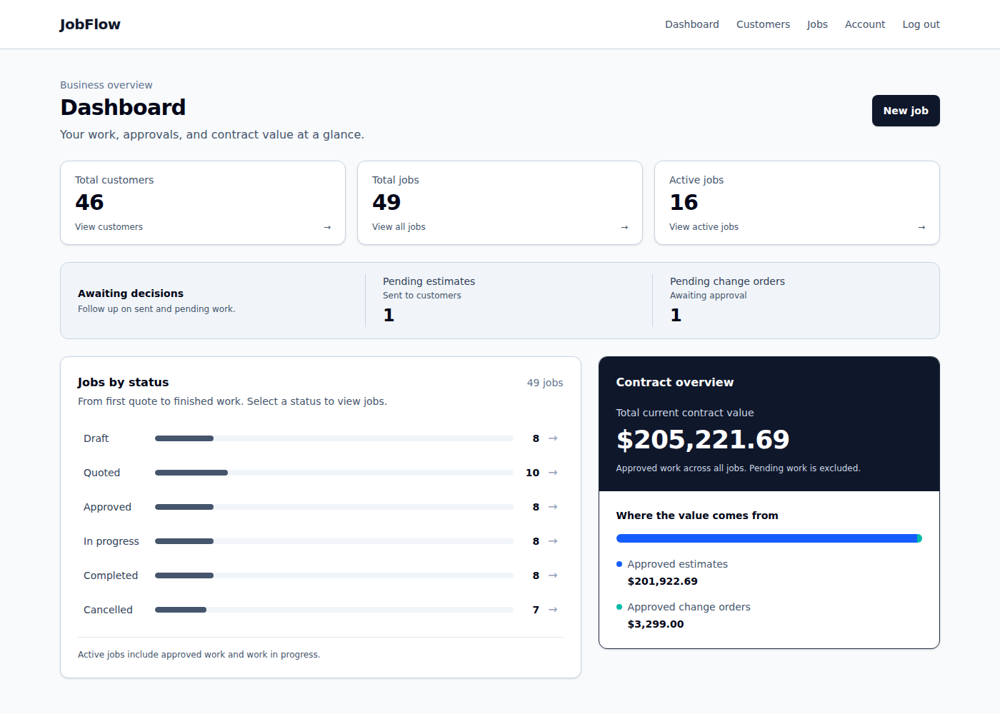
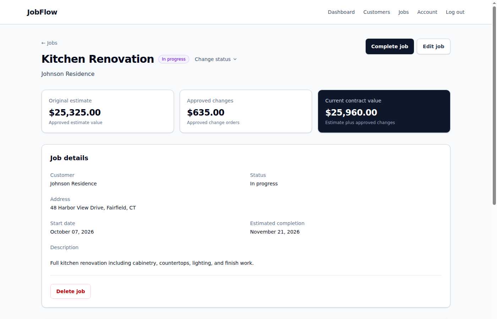
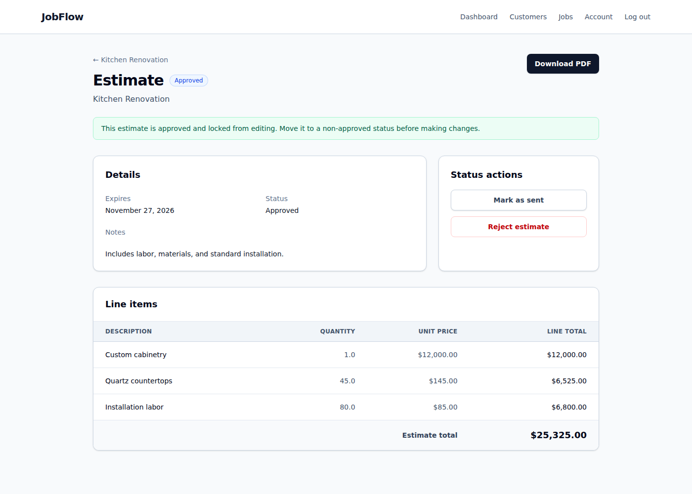
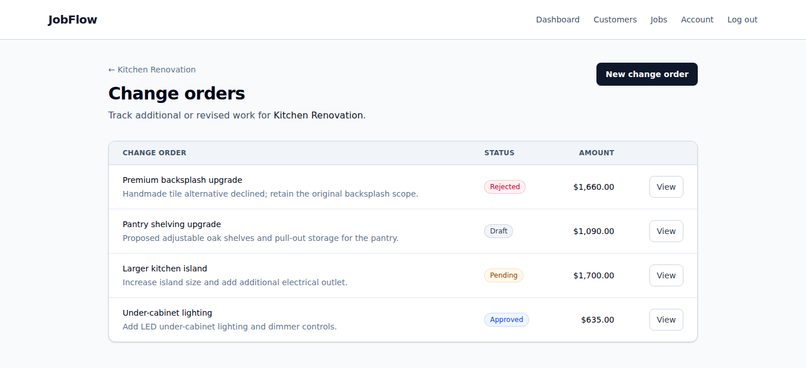
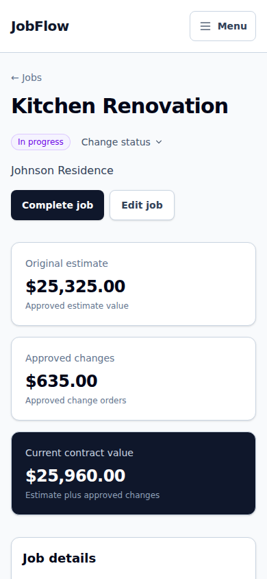

# JobFlow

JobFlow helps contractors manage customers and projects from the first estimate to completed work. It brings scope, approvals, contract values, and project files into one job workspace, so the agreed price stays clear as work changes.

**Customer → Job → Estimate → Change Orders → Completion**

## Live Demo

**[Open JobFlow](https://jobflow.cpllumaj.dev)** · [Follow the 90-second walkthrough](docs/DEMO_WALKTHROUGH.md)

| Demo email | Demo password |
| --- | --- |
| `demo@jobflow.test` | `passwordpassword` |

These credentials are intentionally public and belong only to the demo account. Explore the fictional projects and download sample documents. **Leave shared demo data unchanged; create a separate account to try edits, uploads, approvals, or 2FA.**



*The dashboard connects the business overview to filtered jobs and separates approved contract value from pending work.*

## Features

- **Keep customer and project context together.** Manage contacts, job details, scheduling dates, and statuses; search jobs by name, address, or customer and combine status filters.
- **Price work and track scope changes.** Build estimates and change orders from quantity/unit-price line items. Current contract value includes only approved estimates and approved changes.
- **Prepare documents and keep files with the job.** Export estimate PDFs and attach plans, photos, scope notes, or spreadsheets, with owner-only downloads and upload validation.
- **See what needs attention.** Review active jobs, pending estimates, and pending changes on the dashboard; follow status changes and recorded pricing snapshots in the job's Activity history.
- **Work across screen sizes with a personal account.** Responsive layouts, session-based authentication, password reset, optional authenticator-app 2FA, and ownership isolation keep each user's projects separate.

## Engineering highlights

- **Rails 8 and PostgreSQL:** relational modeling, nested resources, decimal pricing, and derived financial totals without redundant stored balances.
- **Server-rendered ERB and Tailwind CSS:** Turbo navigation/filtering and small Stimulus controllers for line items, upload feedback, and navigation; JavaScript served through import maps.
- **Authorization at resource boundaries:** user-scoped queries, nested ownership checks, protected attachment routes, and a read-only Jobs JSON API using the same authenticated session.
- **Testing and delivery:** Minitest and Capybara/Selenium coverage for workflows and ownership; GitHub Actions tests, lint, and security checks; Docker-based Railway deployment with PostgreSQL, persistent attachments, and background email delivery. See the [deployment guide](docs/DEPLOYMENT.md) for hosting configuration.

## Screenshots

Captured from the live demo on October 30, 2026. Desktop captures use the same 1400 × 1000 viewport, framed to the relevant content; the mobile view uses Chrome emulation at 390 × 844. All project details shown are fictional demo content. Click an image to inspect it at full size.

### Job workspace

Customer context, job status controls, and approved pricing in one view. The kitchen's $25,325 estimate plus $635 in approved changes produces a $25,960 contract value.



<details>
<summary>Estimate and change orders</summary>

### Estimate

Itemized scope, quantity × unit price calculations, approval status, and **Download PDF** for a portable estimate.



### Change orders

Approved, pending, draft, and rejected changes remain visible together; only approved changes affect the contract value.



</details>

<details>
<summary>Mobile view</summary>

### Mobile job workspace

The job header, actions, and financial summary adapt to a narrow screen. This is an emulated browser capture, not a physical-device test.



</details>

## Technical reference

Expand the sections below for implementation and development details.

<details>
<summary>Stack and domain implementation</summary>

## Stack

Versions below come from `.ruby-version` and `Gemfile.lock`.

| Layer | Technology |
| --- | --- |
| Runtime | Ruby 4.0.7; Bundler 2.6.2 |
| Framework | Rails 8.1.4, Active Record, Puma |
| Database | PostgreSQL (`pg` 1.7.0; server version is not pinned) |
| Views and styling | ERB, Tailwind CSS 4.3.3 via `tailwindcss-rails` 4.7.0 |
| Browser behavior | Turbo, Stimulus via `stimulus-rails` 1.3.4, import maps |
| Files | Active Storage; local disk in development and test, persistent storage on Railway in production |
| PDF generation | Prawn and prawn-table |
| Production email and jobs | Resend over HTTPS; Solid Queue |
| Testing | Minitest; Capybara system tests with Selenium and Chrome |

JavaScript is served through import maps; the current development workflow does not require a Node package installation.

## Domain and implementation

```text
User
├── Sessions
└── Customers
    └── Jobs
        ├── Estimate → Estimate line items
        ├── Change orders → Change-order line items
        └── Files (Active Storage)
```

A job belongs to a customer, and a customer belongs to a user. Controllers load jobs through `Current.user.jobs` and nested resources through their owned job. Ownership is inherited rather than copied into redundant user columns.

Each job has at most one estimate and many change orders. Explicit lifecycle actions mark estimates sent and change orders pending, or approve/reject either. Approved records cannot be edited until their status changes. Lifecycle fields are kept separate from ordinary form parameters.

Contract values are computed by the `Job` model rather than stored as additional database columns:

```text
Original estimate value = approved estimate total, otherwise zero
Approved changes = sum of approved change-order totals
Current contract value = original estimate value + approved changes
```

The UI primarily uses server-rendered Rails forms. Stimulus controllers debounce job searches by 300 ms and add/remove nested line items; Turbo updates search results. Dashboard and API queries preload pricing associations to avoid per-job queries.

Job attachments use Active Storage. Attachment access is routed through owned Jobs, and the default Active Storage routes are disabled so file access follows the application's ownership rules.

New uploads allow **PDF, JPG/JPEG, PNG, WEBP, TXT, CSV, DOCX, and XLSX**, up to **20 MB (20,971,520 bytes) per file**, inclusive. These formats cover plans, site photos, scope notes, contracts, and spreadsheets. Executables, scripts, HTML/SVG, archives, macro-enabled Office extensions, legacy DOC/XLS, and other formats are unsupported; export them to a supported format. Existing attachments remain downloadable and removable, and do not need conversion for ordinary job edits.

The browser checks every selected file's size and extension immediately and blocks submission until the selection is corrected. Rails supplies the limit and permitted extensions to Stimulus. Browser MIME values vary, so they are not used to reject otherwise valid selections. Without JavaScript, the same server policy applies after the request arrives. An upstream proxy may reject a large request before Rails can respond; its request-body limit must accommodate multipart overhead and batches of files.

Before handing a batch to Active Storage, the server checks actual uploaded sizes and uses Active Storage's existing Marcel library to detect content without filename or declared-MIME fallback. The detected format must match the extension; a misleading client MIME is replaced with the detected type. TXT/CSV lack reliable signatures, so they additionally require valid UTF-8 text (including ASCII), without binary control bytes. Empty files are rejected. ZIP signatures alone do not qualify as DOCX/XLSX: Marcel must recognize the corresponding Office document structure. This is format identification, not full document parsing, macro inspection, or malware scanning; permitted documents can still contain unsafe content. Older text encodings must be exported as UTF-8.

Any invalid member rejects the entire batch before blobs, attachments, or activity events are created. Successful attachment changes and their activity records remain in the existing locked transaction. Downloads retain owner checks and an attachment disposition.

</details>

<details>
<summary>Local setup and demo data</summary>

## Run locally

Install **Ruby 4.0.7**, PostgreSQL, and the compiler/PostgreSQL client headers needed to build gems. Start PostgreSQL before preparing the database.

The development and test configuration in `config/database.yml` uses local PostgreSQL socket connections with a role matching your operating-system username. That role needs permission to create databases. If it is missing, a PostgreSQL administrator can create it with:

```sh
createuser --createdb YOUR_OS_USERNAME
```

Replace `YOUR_OS_USERNAME` with the account running Rails. If your PostgreSQL installation requires a host, username, or password, configure the local connection using the options described in `config/database.yml`; do not commit credentials.

Configure the three Active Record Encryption environment variables before booting development; see [two-factor authentication setup](docs/TWO_FACTOR_AUTHENTICATION.md). Tests generate disposable encryption keys automatically.

From the repository root:

```sh
gem install bundler -v 2.6.2
bundle install
bin/rails db:prepare
bin/dev
```

Open [http://localhost:3000](http://localhost:3000).

`bin/dev` starts Rails and the Tailwind watcher using `Procfile.dev`; it installs Foreman if it is missing. Development uploads are stored in `storage/`, and test uploads in `tmp/storage/`.

`db:prepare` creates the databases and loads the schema as needed, applies pending migrations, and loads seeds when initializing a new database.

To apply subsequent migrations explicitly:

```sh
bin/rails db:migrate
```

The repository also provides:

```sh
bin/setup --skip-server
```

This installs missing gems, prepares the database, and clears logs/temp files. Run `bin/dev` afterward.

To run Rails without the CSS watcher, first build the styles and then start the server:

```sh
bin/rails tailwindcss:build
bin/rails server
```

### Demo data

To load or refresh the demo data explicitly:

```sh
bin/rails db:seed
```

**Local development seed login:** `demo@jobflow.test` / `passwordpassword` (the live demo uses the credentials listed above).

Seeds create four customers, six jobs (kitchen renovation, bathroom remodel, office buildout, deck replacement, basement finishing, and garage conversion), six estimates, four kitchen change orders, and a kitchen scope attachment. Their varied statuses demonstrate dashboard metrics and approved-versus-pending pricing.

Reseeding resets the demo password and deletes/recreates the demo account's customers and their nested project data. Other users' data is left alone.

To visually test Jobs and Customers pagination in development, opt in explicitly:

```sh
RAILS_ENV=development SEED_PAGINATION=true bin/rails db:seed
```

This keeps the normal demo samples and adds 42 fictional residential customers and 42 jobs, for totals of 46 customers and 48 jobs. The extra jobs cover every status and have searchable project names, customer names, and addresses; try searching for `Residence` across pages or `Kitchen` to narrow the results.

The production `demo:bootstrap` task also accepts `SEED_PAGINATION=true` to load this larger dataset; see the production workflow below. Rerunning either command recreates the same dataset without accumulating duplicates. Regular seeds and database initialization keep the normal dataset unless this flag is explicitly set to `true`. Run `bin/rails db:seed` without the flag to return to the normal local demo dataset; both commands use the demo-only reset behavior described above.

The live demo account is populated with production demo data. Demo seeds abort in production, and production database preparation skips automatic seeding. To explicitly refresh the deployed demo account, use the protected `demo:bootstrap` task described in [the production demo workflow](docs/DEPLOYMENT.md#production-demo-data).

</details>

<details>
<summary>Read-only Jobs API</summary>

## Read-only Jobs API

Sign in through the application, then open these endpoints in the same browser session:

```http
GET /api/v1/jobs
GET /api/v1/jobs/:id
```

Both endpoints use the existing authenticated session; there is no separate API-token scheme. Only jobs owned by the signed-in user are returned.

Unauthenticated requests redirect to sign-in. Missing jobs and another user's jobs both return HTTP 404:

```json
{
  "error": "Job not found"
}
```

Representative index response with illustrative IDs and timestamps:

```json
{
  "jobs": [
    {
      "id": 1,
      "name": "Kitchen Renovation",
      "address": "123 Main Street",
      "status": "in_progress",
      "created_at": "2026-09-01T10:00:00.000Z",
      "updated_at": "2026-09-01T10:00:00.000Z",
      "customer": {
        "id": 1,
        "name": "Johnson Residence"
      },
      "original_estimate_value": "27000.0",
      "approved_change_order_total": "444.0",
      "current_contract_value": "27444.0"
    }
  ]
}
```

The show response uses a `job` wrapper with the same core fields, plus:

- an `estimate` summary containing `id`, `status`, and `total`, or `null` when no estimate exists
- a `change_orders` array containing `id`, `title`, `status`, and `total`

Monetary values are returned as decimal strings. The index is unpaginated and ordered newest first. There are no API write endpoints.

</details>

<details>
<summary>Tests and CI</summary>

## Tests

With PostgreSQL running:

```sh
bin/rails test
bin/rails test:system
```

System tests require Chrome and use headless mode by default. Set `TEST_HEADLESS=false` to run them in a visible browser.

In CI, failed system tests are retried up to twice with `minitest-retry`; each attempt runs Rails setup and teardown, including fixture rollback and browser session cleanup. Unit and integration tests, skipped tests, and normal local runs are not retried. CI logs each failed attempt and reports tests that pass only after retrying. The `screenshots` artifact retains failure screenshots in separate process/class/attempt directories, even when a retry passes; `system-test-logs` retains the console output and Rails test log. A test that fails all three attempts still fails CI.

The suite covers authentication, registration, password reset, ownership isolation, nested-resource access, pricing and lifecycle behavior, attachments, search/filtering, estimate PDFs, dynamic line-item forms, and API responses.

GitHub Actions CI is configured with Rails tests, system tests, RuboCop linting, and Ruby/gem/JavaScript security checks. The workflow runs on pull requests and pushes to `main`.

To run the API tests alone:

```sh
bin/rails test test/controllers/api/v1/jobs_controller_test.rb
```

</details>

## Production deployment

JobFlow is deployed on **Railway** at **[jobflow.cpllumaj.dev](https://jobflow.cpllumaj.dev)**, with a custom domain managed through **Cloudflare**, PostgreSQL, and persistent storage for Active Storage attachments. Production password-reset email uses Resend over HTTPS with Solid Queue. The live demo credentials are listed above.

See [the production deployment checklist](docs/DEPLOYMENT.md) for database, secrets, persistent storage, TLS, mail delivery, build requirements, and the production demo refresh workflow. The generated Kamal deployment template remains separate from the current Railway deployment and requires hosting-specific configuration.
